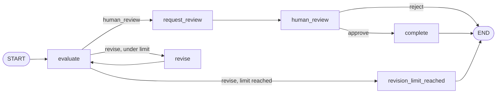

# Task 4: Resumable Review Workflow

This is a LangGraph workflow that evaluates a content item, sends it back for revision when the evaluator asks (which is at most twice evaluated), pauses for a human to review, and finishes it once approved. The state is checkpointed in SQLite at the review pause, so a reviewer can approve hours later from a brand-new process and nothing that already ran is run again.

Everything runs locally. No API keys, no network, no paid models: the evaluator and the reviser are deterministic fakes driven by fixtures.

- **Task:** [Task 4, Resumable Review Workflow](../../challenge/tasks/task-4.md)
For my stack I used the following technologies and versions:
- **Stack:** Python 3.11+, LangGraph 1.2, `langgraph-checkpoint-sqlite`, Pydantic v2, pytest

---

## Quick start

From the repository root:

```bash
cd src/task-4_abiodun-alao
python3 -m venv .venv
source .venv/bin/activate
pip install -r requirements.txt

pytest -q # The test will run and resolve to 35 passed
```

Then walk through a run. Each command is a separate process, so this is also a real restart test:

```bash
python -m workflow run content-001           # This will evaluate, then revise once, then evaluate, and pause for review
python -m workflow status content-001        # This shows the saved state: awaiting_review, revision_count 1
python -m workflow resume content-001        # This asks approve/reject; answer "a"
python -m workflow resume content-001        # This will again show: "Already completed", nothing repeated
python -m workflow events content-001        # This shows the full event log as JSON

python -m workflow run content-001 --scenario always_revise --run-id limit-001   # This stops at the limit
python -m workflow run fixtures/content/malformed/missing-body.json              # This will exit with code 2
```

`resume` also takes `--decision approve|reject --reviewer NAME --note TEXT` to skip the prompt. To start over, delete `data/`.

Recorded output of all of the above is in [`examples/`](examples/).

### Commands

| Command | What it does |
| --- | --- |
| `run CONTENT [--scenario NAME] [--run-id ID] [--max-revisions N]` | Starts a run. `CONTENT` is a content ID from `fixtures/content/` or a path to a JSON file. Scenario defaults to `revise_once`, run ID to the content ID, max revisions to 2. |
| `resume RUN_ID [--decision approve\|reject] [--reviewer NAME] [--note TEXT]` | Continues a run paused at human review. Without `--decision` it asks. |
| `status RUN_ID` | Where the run is, read from the saved checkpoint. |
| `events RUN_ID` | The run's event log as JSON. |

---

## How it works

```text
 cli.py        parse arguments, print the events this command produced, map errors to exit codes
    │
 service.py    register runs, guard finished runs, record checkpoint events, resume with Command(resume=)
    │
 graph.py      the LangGraph StateGraph: nodes, routing, interrupt() at human review
    │
 storage.py    one SQLite file: LangGraph checkpoints + our event log + a small run registry
```

### The graph



| Node | Job | Event(s) |
| --- | --- | --- |
| `evaluate` | Calls the evaluator, stores the verdict, counts the attempt | `evaluation_completed` |
| `revise` | Calls the reviser with the evaluator's reasons, counts the revision | `revision_requested`, `revision_completed` |
| `revision_limit_reached` | Terminal: stops with a written reason | `revision_limit_reached` |
| `request_review` | Marks the run `awaiting_review`, bumps `checkpoint_version` | `human_review_required` |
| `human_review` | **Pauses** with `interrupt()`. On resume, validates the reviewer's decision | `human_approved` / `human_rejected` |
| `complete` | Terminal: marks the run completed | `workflow_completed` |

Review is split into two nodes on purpose. LangGraph re-runs an interrupted node from its first line when it resumes, so `human_review` has nothing before `interrupt()`. Recording "review required" lives in `request_review`, which has already finished and been checkpointed by the time the run pauses. Doing it inside `human_review` would log the event a second time on every resume.

### Design note

**Workflow state.** `WorkflowState` (in `workflow/models.py`) is a Pydantic model and is what LangGraph checkpoints:

| Field | Why it's there |
| --- | --- |
| `run_id` | Identifies the run; also the LangGraph `thread_id` |
| `content` | The full `ContentItem`, including any revisions so far |
| `max_revisions` | The limit, stored per run (default 2, allowed 0 to 10) |
| `revision_count`, `evaluation_count` | Progress counters; routing reads `revision_count` |
| `last_evaluation` | The evaluator's validated verdict and reasons |
| `status` | `running`, `awaiting_review`, `completed`, `rejected`, `revision_limit_reached` |
| `review` | The reviewer's decision once given |
| `stop_reason` | Plain-English reason for any terminal stop other than completion |
| `checkpoint_version` | Bumped each time the run reaches review |

Nodes return only the fields they change, and LangGraph merges them into the state.

**Routing conditions.** Two conditional edges, both plain functions returning a `Literal` of node names.

- After `evaluate`: `human_review` goes to review. `revise` goes to `revise` while `revision_count < max_revisions`, otherwise to `revision_limit_reached`.
- After `human_review`: approve goes to `complete`. Reject ends the run.

Routing reads only the evaluator's validated `Decision` enum and the counters, never the content text. The evaluator's output is parsed into `EvaluationResult`, which only allows `revise` or `human_review`, so an evaluator (or content pretending to be one) can't answer "approve". `content-002-injection.json` is a content item whose body tells the system to approve it. It's routed exactly like normal content (`test_instructions_in_content_do_not_change_routing`).

**How the revision limit is enforced.** The check `revision_count < max_revisions` sits in the routing function, which is the only way into `revise`. With the default of 2, that gives three evaluations and two revisions, then a terminal `revision_limit_reached` status with a `stop_reason` that names the numbers. The limit is a per-run setting (`--max-revisions`), and `test_the_limit_is_configurable` runs it at 0. Because every loop back to `evaluate` passes through `revise`, which raises the counter, the loop can't run forever.

**How checkpoints are persisted.** The graph is compiled with LangGraph's `SqliteSaver`. LangGraph writes a checkpoint after every step, keyed by `thread_id` (our `run_id`). When `human_review` calls `interrupt()`, the run stops and the latest checkpoint holds the full state plus the fact that `human_review` is next. A few details matter:

- The saver gets its own SQLite connection, because it manages its own transactions. The event log and run registry share a second one. WAL mode is on so two processes can use the file at once.
- The serializer has an explicit allow-list of our Pydantic types (`CHECKPOINT_TYPES` in `storage.py`). Without it, LangGraph warns today and in strict mode silently hands back plain dicts. The tests run with `LANGGRAPH_STRICT_MSGPACK=true`, and `test_checkpoint_allowlist_covers_every_state_type` reads the raw checkpoint to prove the types come back intact.
- After LangGraph returns, the service records `checkpoint_saved` with LangGraph's own `checkpoint_id`, so an event can be matched to the exact checkpoint row. It's recorded after the save, never claimed in advance from inside a node.

**How resume works.** `resume` is a new process with nothing in memory.

1. Look up the run in the `workflow_runs` registry to find which evaluator scenario it used, and rebuild the same graph. LangGraph saves state, not components.
2. Read the saved state with `get_state`. If the run already finished, stop (see duplicate approval below). If it isn't paused at `human_review`, refuse with a clear error.
3. Record `checkpoint_loaded`, then call `invoke(Command(resume=decision))` on the same `thread_id`. LangGraph loads the checkpoint and continues from `human_review`, where `interrupt()` now returns the reviewer's decision.

Nothing before the checkpoint runs again. The evaluator and reviser fakes count their calls, and `test_resume_does_not_rerun_evaluation_or_revision` asserts the counts don't move on resume. The event log shows it as well, with no new `evaluation_completed` or `revision_*` events after `checkpoint_loaded`.

**How duplicate approval is prevented from duplicating completion.** There are three independent layers, each tested on its own:

1. **Service guard.** `resume` reads the saved status first. For a finished run it does nothing except record a `duplicate_approval_ignored` (or `resume_ignored`) event, and exits 0. A second approval is a harmless no-op, not an error.
2. **The graph itself.** A completed thread has no next node, so even a direct `invoke` on it runs nothing.
3. **Idempotent events.** Every progress event has a fixed key (`evaluation:2`, `review_decision:1`, `completed`) under a `UNIQUE(run_id, event_key)` constraint with `INSERT OR IGNORE`. If two approvers race past layer 1 at the same moment and `complete` really runs twice, the database still keeps a single `workflow_completed`. Attempt events (`checkpoint_loaded`, `duplicate_approval_ignored`) get random keys, because every attempt is real and worth seeing.

`test_completion_is_recorded_once_even_if_complete_runs_twice` replays that race deterministically, by resuming a second time from the old paused checkpoint after the first approval finished. A timing-based race test can pass by luck; this one can't.

---

## Event log

Stored in the `workflow_events` table of the same SQLite file. Print it with `python -m workflow events RUN_ID`. Abridged from [`examples/01-event-log.json`](examples/01-event-log.json), where the `at` timestamps and full payloads are shown:

```json
[
  {"seq": 1,  "event": "run_started", "scenario": "revise_once", "max_revisions": 2},
  {"seq": 2,  "event": "evaluation_completed", "attempt": 1, "decision": "revise", "revision_count": 0},
  {"seq": 3,  "event": "revision_requested", "revision_count": 1, "feedback": ["The 18% figure needs its date range"]},
  {"seq": 4,  "event": "revision_completed", "revision_count": 1},
  {"seq": 5,  "event": "evaluation_completed", "attempt": 2, "decision": "human_review", "revision_count": 1},
  {"seq": 6,  "event": "human_review_required", "checkpoint_version": 1},
  {"seq": 7,  "event": "checkpoint_saved", "checkpoint_id": "1f1d06eb-...", "next_node": "human_review"},
  {"seq": 8,  "event": "checkpoint_loaded", "checkpoint_id": "1f1d06eb-...", "stage": "human_review"},
  {"seq": 9,  "event": "human_approved", "reviewer": "ada"},
  {"seq": 10, "event": "workflow_completed", "approved_by": "ada"},
  {"seq": 11, "event": "duplicate_approval_ignored", "status": "completed"}
]
```

Events 1 to 7 come from the `run` process and 8 to 10 from the `resume` process. Event 11 is the second approval, which changed nothing. What the CLI prints is generated from these events, so the screen and the stored history can't disagree.

---

## Tests

```bash
pytest -q 
```

| Required check | Test (in `tests/test_required_checks.py`) | What it proves |
| --- | --- | --- |
| Normal pass to human review | `test_normal_pass_reaches_review_is_persisted_and_completes` | Pauses at review, the state is read back from the checkpoint table, then approval completes it. Exact event list. |
| One revision then pass | `test_one_revision_then_pass_full_sequence` | The full event order for all eight steps in the spec, each step labelled in the test. |
| Retry limit | `test_retry_limit_stops_after_two_revisions_with_a_clear_reason` | Exactly 3 evaluations and 2 revisions, terminal `revision_limit_reached`, reason stated, never reaches review. |
| Restart at review | `test_restart_at_review_resumes_without_rerunning_work` | `run` and `resume` are **two separate OS processes** (`subprocess`). The second prints no evaluation or revision, and the event counts don't change. |
| Duplicate approval | `test_duplicate_approval_does_not_duplicate_completion` | Second approval exits 0, one completion, one approval, the ignored attempt logged, and **no new checkpoint written** (proof no node ran). |
| Malformed input | `test_malformed_input_fails_predictably_and_creates_nothing` | Four kinds of bad input (missing field, bad ID and empty title, unknown field, broken JSON). Exit 2, a readable error, and zero rows in every table. |

Supporting tests:

- **`tests/test_graph.py`** drives the graph directly:
  - the call-counter proof that resume doesn't rerun work
  - the configurable limit
  - reject
  - the prompt-injection fixture
  - the checkpoint type round-trip
  - the deterministic completion race
- **`tests/test_inputs.py`** covers the Pydantic contracts and the error messages.
- **The rest of `tests/test_required_checks.py`** covers:
  - a realistic two-process simultaneous approval
  - unknown scenarios, including a `../` path
  - unknown runs
  - starting the same run twice
  - the `events` command

**How I checked the tests themselves.** I broke the code on purpose in five ways. Each time a test failed, and the suite passed again once I put the code back:

- off-by-one in the limit
- a missing type in the checkpoint allow-list
- removing the "already finished" guard
- a side effect placed before `interrupt()`
- a non-unique completion key

The last one is how I found that the two-process race test alone wasn't enough, which is why the deterministic replay test exists.

---

## Fixtures and assumptions

All fixtures live in this folder. Task 4 has no supplied fixtures in the repo's root `fixtures/`, so nothing is copied from there.

| Fixture | Purpose |
| --- | --- |
| `fixtures/content/content-001.json` | Normal content item with evidence IDs |
| `fixtures/content/content-002-injection.json` | Content whose body tells the system to approve it |
| `fixtures/content/malformed/*.json` | Missing `body`; path-like ID and blank title; unknown `status` field; invalid JSON |
| `fixtures/evaluator/pass.json` | Evaluator says `human_review` straight away |
| `fixtures/evaluator/revise_once.json` | `revise`, then `human_review` |
| `fixtures/evaluator/always_revise.json` | `revise` every time |

**Assumptions that I made:**

- **Evaluator scripts are keyed by attempt number.** Attempt 1 gets the first response, attempt 2 the second, and past the end the last response repeats. That's how `always_revise` stays at a single line.
- **The reviser is a fake.** It appends a marked note with the evaluator's reasons to the body. The interfaces (`Evaluator`, `Reviser` protocols in `components.py`) are what a real model would plug into.
- **At the revision limit the run stops** with the terminal status `revision_limit_reached`. The spec allows either a terminal state or human review. I chose a terminal state so that "the limit was hit" is never confused with "the content passed".
- **Reviewers can approve or reject.** Rejection is terminal and records the optional note.
- **The run ID defaults to the content ID,** matching the spec's `python -m workflow resume content-001`. Use `--run-id` to run the same content more than once.
- **The reviewer's name is self-declared** (`--reviewer`, defaulting to the OS user name). The spec excludes authentication.

---

## Trade-offs

- **LangGraph's checkpointer for state, a separate table for events.** The checkpointer is the source of truth for where a run is; the event log is the human-readable history. Keeping them apart means the log can be keyed for idempotency and read without knowing LangGraph's storage format. The cost is two writes that aren't in one transaction (see limitations).
- **SQLite, one file.** Enough for a local, single-machine demo, inspectable with any SQLite browser, and nothing to install. Not a multi-host store.
- **A run registry next to the checkpoints.** Resume needs to rebuild the graph with the same components, which LangGraph doesn't store. One small table also gives a clean "run already exists" error.
- **Separate `request_review` and `human_review` nodes.** One extra node so the pause node has no side effects before `interrupt()`.
- **Duplicate approval is a successful no-op (exit 0), not an error.** Matches "safely idempotent": a retried command or a double click shouldn't look like a failure.
- **CLI output built from events.** Slightly more code than printing from nodes, but the printed story and the stored story can't drift apart.
- **No optional extension.** I focused on the required behaviour. Transient-failure retry would be the natural next step (see limitations).

## The limitations

- **No `continue` after a crash mid-run.** A run that dies before the review pause can't be picked up yet, although LangGraph has the checkpoints to support it.
- **Events and checkpoints aren't written in one transaction.** A crash between the two writes can leave a checkpoint without its log line. The state stays correct.
- **In a true simultaneous race, `complete` can run twice.** The log still keeps one completion, but a real completion action (publishing, say) would need its own idempotency key.
- **The fake reviser skips re-validation** (`model_copy`). A real reviser should return a validated `ContentItem`.
- **Rejected and limit-reached runs are final.** No cancellation, and the optional transient-failure extension isn't implemented.

---


---

## The Structural Layout of how I setup the project

```text
task-4_abiodun-alao/
├── README.md
├── requirements.txt          pinned versions
├── pytest.ini
├── workflow/
│   ├── __main__.py           python -m workflow
│   ├── cli.py                commands, output, exit codes
│   ├── service.py            run, resume, status, events; duplicate guard
│   ├── graph.py              LangGraph nodes, routing, interrupt
│   ├── models.py             Pydantic contracts and WorkflowState
│   ├── inputs.py             loading and validating JSON input
│   ├── components.py         Evaluator / Reviser interfaces and fakes
│   ├── storage.py            SQLite: checkpointer + event log + run registry
│   ├── events.py             idempotent event log
│   └── runs.py               run registry
├── fixtures/                 content items, malformed inputs, evaluator scripts
├── tests/                    35 tests
└── examples/                 recorded CLI sessions and event logs, plus explore_graph.py
```

## How this was built

Built while learning LangGraph, in pair-programming sessions with Claude (Anthropic), which wrote the first version of each stage. I made the design calls, built and debugged each stage locally, and checked every flow by hand. Details are in the pull request.